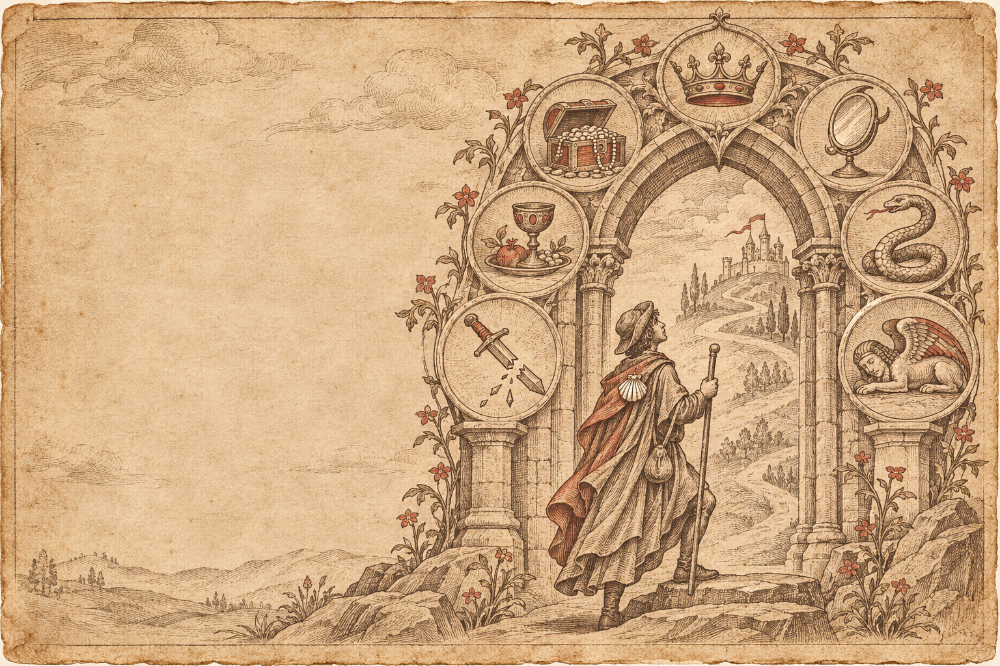

# 7 Deadly Sins Test — Discover Your Dominant Sin

**Are you ruled by Pride, Greed, Lust, Envy, Gluttony, Wrath, or Sloth?**

Discover the darker side of your personality with the **7 Deadly Sins Test**, a free online personality quiz inspired by the seven deadly sins.

Explore your personality traits, uncover your dominant sin, and learn how the seven deadly sins may reflect everyday thoughts, emotions, and behaviors.

### 🔥 Take the Free 7 Deadly Sins Test

**👉 [Start the 7 Deadly Sins Test](https://7deadlysins-test.org/)**

No complicated setup. Just explore your personality and discover which of the seven deadly sins resonates with you most.

---

## 😈 What Is the 7 Deadly Sins Test?

The **7 Deadly Sins Test**, also known as the **Seven Deadly Sins Personality Test**, is an online personality quiz inspired by seven traditional human vices.

The seven deadly sins have appeared throughout history in religion, literature, philosophy, art, and popular culture.

Today, they also provide an interesting framework for exploring human behavior and personality.

Our online test invites you to reflect on seven personality dimensions:

- Pride
- Greed
- Lust
- Envy
- Gluttony
- Wrath
- Sloth

The goal is simple: **discover which deadly sin best represents your personality tendencies.**

This quiz is designed for entertainment and personal reflection, not clinical psychological assessment.

---

## 🧠 The Seven Deadly Sins Explained

### 👑 1. Pride — Superbia

Pride is associated with excessive self-importance, arrogance, and the desire for recognition.

People who strongly identify with Pride may value achievement, independence, status, and admiration.

**Explore Pride:**  
https://7deadlysins-test.org/sins/pride

### 💰 2. Greed — Avaritia

Greed represents an excessive desire for wealth, possessions, power, or personal gain.

It can reflect ambition, competitiveness, and the pursuit of more than one truly needs.

**Explore Greed:**  
https://7deadlysins-test.org/sins/greed

### ❤️ 3. Lust — Luxuria

Lust is traditionally associated with intense desire and the pursuit of physical or emotional gratification.

In personality discussions, it may relate to attraction, passion, and the strength of personal desires.

**Explore Lust:**  
https://7deadlysins-test.org/sins/lust

### 🐍 4. Envy — Invidia

Envy emerges when we compare ourselves with others and desire what they possess.

It may involve jealousy, insecurity, competition, or dissatisfaction with personal circumstances.

**Explore Envy:**  
https://7deadlysins-test.org/sins/envy

### 🍰 5. Gluttony — Gula

Gluttony represents excessive consumption and difficulty recognizing when enough is enough.

Beyond food, it can symbolize overindulgence in comfort, pleasure, and material experiences.

**Explore Gluttony:**  
https://7deadlysins-test.org/sins/gluttony

### 🔥 6. Wrath — Ira

Wrath is associated with intense anger, hostility, resentment, and emotional reactions.

It may reflect how people respond to frustration, perceived injustice, and interpersonal conflict.

**Explore Wrath:**  
https://7deadlysins-test.org/sins/wrath

### 💤 7. Sloth — Acedia

Sloth represents avoidance, apathy, procrastination, and reluctance to take action.

It may appear as difficulty maintaining motivation or engaging with responsibilities.

**Explore Sloth:**  
https://7deadlysins-test.org/sins/sloth

---

## 🎯 How Does the 7 Deadly Sins Personality Test Work?

The test explores personality tendencies associated with the seven deadly sins.

### Step 1: Start the Quiz

Visit the official website and begin the personality test.

### Step 2: Answer Honestly

Reflect on your natural reactions, preferences, emotions, and behaviors.

### Step 3: Discover Your Results

Explore your dominant deadly sin and what it may suggest about your personality.

### Step 4: Reflect on Your Personality

Use your results as a starting point for self-discovery and personal reflection.

**👉 [Take the Free Personality Test](https://7deadlysins-test.org/)**

---

## 🌟 Why Take the Seven Deadly Sins Quiz?

The seven deadly sins offer a memorable way to explore different aspects of human nature.

Taking the test can help you:

- Explore your personality through a different perspective.
- Reflect on your motivations and emotional tendencies.
- Discover which of the seven deadly sins resonates with you.
- Learn about the historical meanings of the seven deadly sins.
- Start interesting conversations with friends.

Whether you're curious about psychology, personality quizzes, or the history of the seven deadly sins, this test offers an entertaining way to explore yourself.

---

## ❓ Frequently Asked Questions

### What is my deadly sin?

Your dominant deadly sin is the personality dimension that most closely matches your responses in the quiz.

Take the test to explore your result.

### Is the 7 Deadly Sins Test free?

The 7 Deadly Sins Test is available online for free.

### What are the seven deadly sins?

The traditional seven deadly sins are Pride, Greed, Lust, Envy, Gluttony, Wrath, and Sloth.

### Is the Seven Deadly Sins Test scientifically accurate?

The quiz is intended for entertainment and self-reflection. It should not be treated as a clinically validated personality assessment or psychological diagnosis.

### Can someone have more than one deadly sin?

Yes. People may recognize aspects of several deadly sins in their personalities.

The seven categories are not mutually exclusive descriptions of human behavior.

### Which deadly sin is the worst?

Traditionally, Pride has often been described as a foundational sin in Christian theology.

However, interpretations vary across religious, philosophical, and cultural traditions.

### Where can I take the 7 Deadly Sins Personality Test?

You can take the test online at:

**https://7deadlysins-test.org/**

---

## 📚 Learn More

Explore additional information about the seven deadly sins:

- [The Seven Deadly Sins Explained](docs/seven-deadly-sins.md)
- [How the Personality Test Works](docs/how-the-test-works.md)
- [Frequently Asked Questions](docs/faq.md)

---

## 🌐 Official Website

**7 Deadly Sins Test**

https://7deadlysins-test.org/

Discover your dominant sin and explore the seven sides of human nature.

### 👉 [Discover Your Deadly Sin Now](https://7deadlysins-test.org/)

---

## 🤝 Feedback and Contributions

Have suggestions for improving the project?

We welcome feedback, ideas, and discussions about the Seven Deadly Sins Test.

You can open a GitHub issue to share your thoughts.

---

## 📄 License

The materials in this repository are available under the MIT License, unless otherwise noted.

The official personality test and website are hosted separately at:

https://7deadlysins-test.org/

---

**7 Deadly Sins Test — Which Sin Defines You?**
